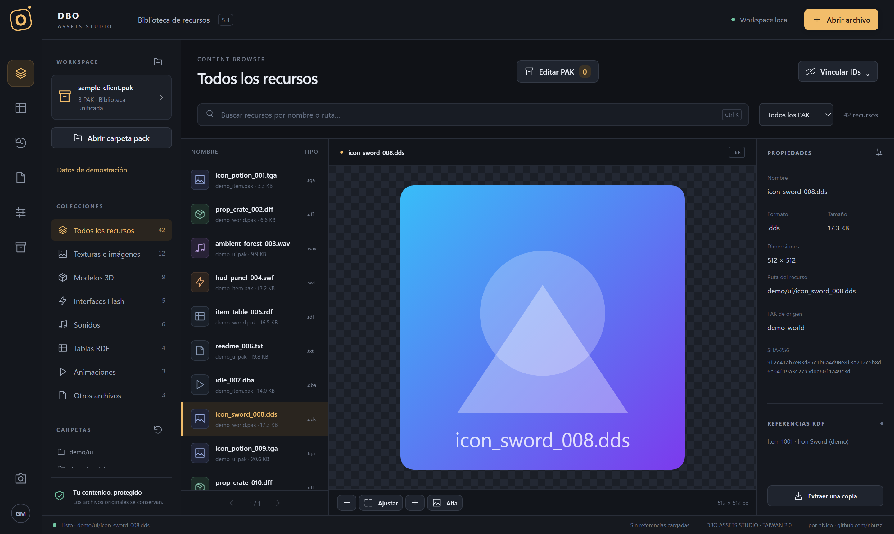
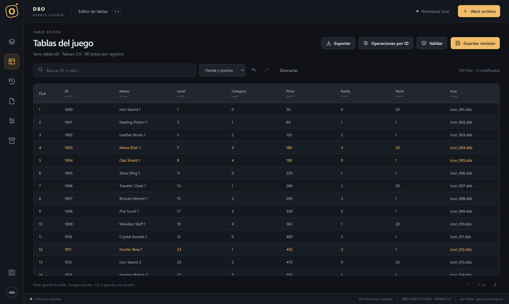

# DBO Assets Studio

Open source desktop and command-line tool to **browse, inspect and edit the assets and tables of a Dragon Ball Online (Taiwan 2.0 format) client and server** — for your own assets and your own servers.

> **Español:** herramienta de código abierto para explorar y editar los PAK, tablas RDF, WPS/TQS y recursos de un cliente/servidor de Dragon Ball Online (formato Taiwan 2.0). Abajo hay una guía rápida en español.

[](https://github.com/nbuzzi/dbo-assets-studio/releases)   [](LICENSE)

[Download](https://github.com/nbuzzi/dbo-assets-studio/releases/latest) · [Quick start](#quick-start) · [Issues](https://github.com/nbuzzi/dbo-assets-studio/issues)

## Features

- **PAK explorer** – open Taiwan-format PAK indexes, browse entries, preview and extract resources (models, textures, DDS/TGA, SWF via Ruffle, audio).
- **PAK packaging** – build overlay / repack candidates with plan, hashes and audit trail; originals are never modified.
- **RDF table editor** – schema-aware editing of server/client tables, validation, diff review, additive imports, text tables.
- **WPS / TQS editor** – visual editor for World Play Scripts and Time Quest Scripts (dungeon flows, stages, rewards), plus a quest editor.
- **Asset tools** – model/texture/effect inspection and repair helpers, map and terrain workshop, 3D viewport.
- **Projects & deliveries** – versioned workspace that tracks your changes and exports a ZIP with manifest and hashes.
- **CLI** – `dbo-assets` exposes the same services as the UI for scripting (`dbo-assets help`).

Safety model: every write goes to a **new output folder** with the original preserved, a plan and an audit file. Nothing is installed into a game or server directory for you.

## What this project does *not* contain

- No game assets, no client, no server files, no PAK keys.
- No code from the Dragon Ball Online client/server source.
- It is an independent community project, **not affiliated with or endorsed by** the original developers or publishers of Dragon Ball Online. You need your own, legitimately obtained client/server files, and you are responsible for complying with the applicable licenses and laws.

## Screenshots

<p align="center">
  
</p>
<p align="center"><sub>Resource browser: PAK library, collections, live preview and inspector.</sub></p>

<p align="center">
  
</p>
<p align="center"><sub>Schema-aware RDF table editor with pending-change highlighting. Screenshots use synthetic demo data.</sub></p>

## Quick start

1. Download the latest zip from [Releases](https://github.com/nbuzzi/dbo-assets-studio/releases/latest) and extract it.
2. Install the [WebView2 Runtime](https://developer.microsoft.com/microsoft-edge/webview2/) if you don't have it (it ships with Windows 11).
3. Copy `studio.config.example.json` to `studio.config.json` and set your own `pakKey` (see [Configuration](#configuration-your-pak-key)).
4. Build `pak-tool.exe` against your own client sources ([Build](#build)) and put it next to `DboAssetsStudio.exe`.
5. Run `DboAssetsStudio.exe`.

Features that read or write PAK archives need `pak-tool.exe`.

## Download

Prebuilt portable Windows x64 build (self-contained, no .NET install needed): see the [Releases](https://github.com/nbuzzi/dbo-assets-studio/releases) page. It does **not** include `pak-tool.exe` (it must be built against your own client sources, see below) nor any PAK key.

## Requirements

- Windows 10/11 x64
- [.NET 8 SDK](https://dotnet.microsoft.com/download/dotnet/8.0) (to build)
- [Microsoft Edge WebView2 Runtime](https://developer.microsoft.com/microsoft-edge/webview2/) (the UI runs on it)
- Python 3 (only to fetch the web dependencies at build time)

## Configuration: your PAK key

The PAK index of the client is encrypted. **The key is not shipped with this repository** and is never compiled into the program. You provide it locally:

1. Copy `studio.config.example.json` to `studio.config.json` (this file is git-ignored).
2. Put the key of your own client in it:

   ```json
   { "pakKey": "YOUR-PAK-KEY" }
   ```

Lookup order for the configuration file: `DBO_STUDIO_CONFIG` env var → next to the executable → current directory → `%LOCALAPPDATA%\DBO Assets Studio\`. The environment variable `DBO_PAK_KEY` overrides the file.

The app passes the key to the native helper through its environment (never on the command line).

> **Never commit `studio.config.json`.** If you fork this repo, double-check `git status` before pushing.

## Build

```powershell
# 1. Managed app + CLI
.\build.ps1 -OutputDirectory .\dist

# 2. Native PAK helper (needs YOUR copy of the DBO client Util sources: NtlFileSerializer.h, md5.h, Util.lib x86)
.\build-pak-tool.ps1 -UtilPath C:\path\to\NtlLib\Shared\Util
.\build.ps1 -OutputDirectory .\dist -PakTool .\native\bin\pak-tool.exe
```

The `native/` folder also contains reference C++ helpers (property/scene/terrain readers). They are built against the DBO client sources and are **not required** to build or run the managed application, but features that rely on them need the matching helper executables next to the app.

## Usage

```text
DboAssetsStudio.exe                      # desktop UI
dbo-assets help                          # CLI reference
dbo-assets pak inspect <index.pak>
dbo-assets pak list <index.pak> --filter .rdf
dbo-assets pak extract <index.pak> <path-inside-pak> <new-folder>
```

## Guía rápida (español)

1. Instalá .NET 8 SDK y WebView2 Runtime.
2. Copiá `studio.config.example.json` → `studio.config.json` y completá `pakKey` con la clave de **tu propio** cliente. Ese archivo no se sube al repo.
3. Compilá con `build.ps1`. Para leer PAK necesitás además `pak-tool.exe` (ver `build-pak-tool.ps1`; requiere tus propias fuentes del cliente).
4. Abrí `DboAssetsStudio.exe`, elegí un PAK/RDF/WPS y trabajá sobre **copias**: la herramienta siempre genera candidatos en una carpeta nueva y deja el original intacto.

## Troubleshooting

- **"Falta la clave de los PAK" / missing PAK key:** create `studio.config.json` (or set `DBO_PAK_KEY`). See [Configuration](#configuration-your-pak-key).
- **PAK features do nothing / pak-tool not found:** `pak-tool.exe` must sit next to the app. Build it with `build-pak-tool.ps1`.
- **Blank window:** install the WebView2 Runtime.

## Contributing

Issues and pull requests are welcome, see [CONTRIBUTING.md](CONTRIBUTING.md). Please do **not** attach game assets, client files or keys to issues or PRs.

## About the author

Created and maintained by **nNico**.
More projects and contact: **[github.com/nbuzzi](https://github.com/nbuzzi/)**

## License

[MIT](LICENSE) © nNico
